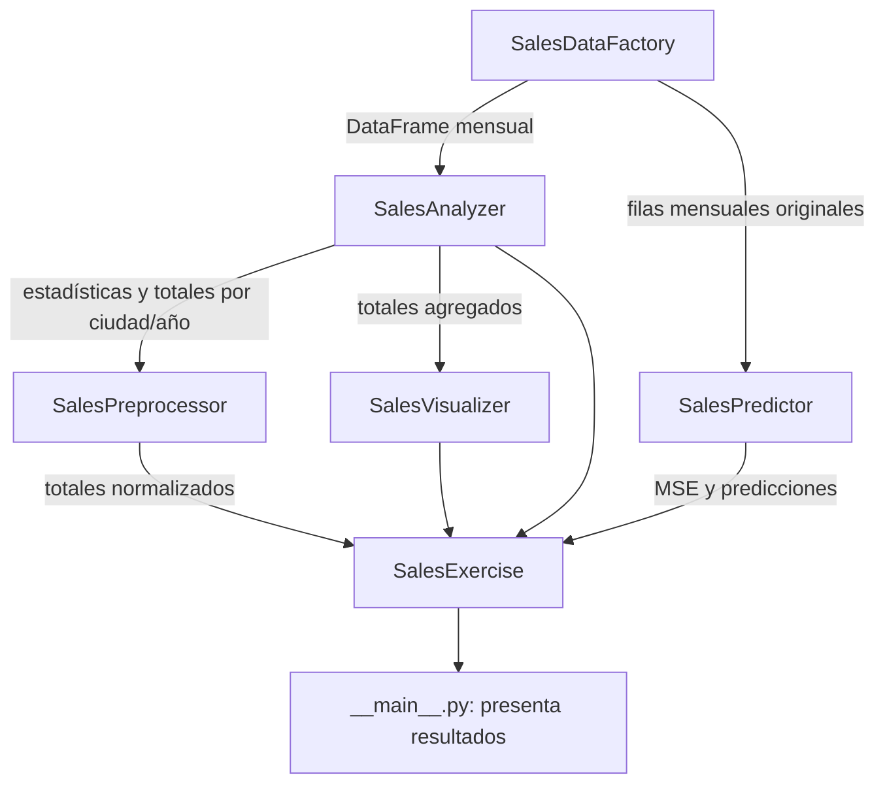

# Arquitectura del ejercicio: análisis de ventas minoristas

Este documento describe la implementación del ejercicio de [ejercicio.md](./ejercicio.md): estructura, clases, flujo y decisiones de diseño. El diseño es didáctico y modular, sin añadir capas que no aporten claridad.

## Principios de diseño

- Mantener el DataFrame como formato de intercambio entre los componentes de análisis.
- Separar preparación de datos, análisis, visualización y modelado.
- Dar a cada clase una responsabilidad principal y métodos fáciles de probar.
- No modificar silenciosamente el DataFrame recibido; devolver resultados nuevos cuando se transformen los datos.
- Usar la tabla mensual original para el modelo. Los totales agrupados por ciudad y año se utilizan para el gráfico y la normalización del análisis, no como sustitutos de las filas de entrenamiento.

## Estructura propuesta

```text
Scikit-learn/
├── docs/
│   ├── ejercicio.md
│   └── arquitectura_ejercicio.md
├── src/
│   └── ventas_minoristas/
│       ├── __init__.py
│       ├── datos.py
│       ├── analisis.py
│       ├── preprocesamiento.py
│       ├── visualizacion.py
│       ├── modelo.py
│       └── flujo.py
├── tests/
│   └── test_ventas_minoristas.py
├── pyproject.toml
├── pyrightconfig.json
├── pytest.ini
└── requirements.txt
```

`src/ventas_minoristas/` contiene la lógica reutilizable y las clases del ejercicio. `__main__.py` es el punto de entrada del paquete; `tests/` verifica el flujo y sus componentes sin abrir ventanas gráficas. `pyproject.toml` declara el paquete, sus dependencias y el comando de consola; `pytest.ini` configura la ruta de pruebas y `pyrightconfig.json` la resolución del código fuente en el editor.

Instala el proyecto y las dependencias de prueba en modo editable con `python -m pip install -e ".[test]"`, ejecuta las pruebas con `python -m pytest` y lanza el ejercicio desde la raíz con `python -m ventas_minoristas` o con el comando `ventas-minoristas`.

## Componentes y clases

### `datos.py` — `SalesDataFactory`

Construye el DataFrame a partir de los 12 registros indicados en el ejercicio.

- `create_dataframe() -> pandas.DataFrame`: devuelve una copia nueva con `Ciudad`, `Año`, `Mes` y `Ventas`.
- No lee archivos: los datos del ejercicio son pequeños y están especificados directamente como registros.

### `analisis.py` — `SalesAnalyzer`

Realiza operaciones descriptivas con Pandas, sin dibujar gráficos.

- `check_missing_values(df)`: informa de valores faltantes.
- `describe_sales(df)`: calcula estadísticas descriptivas de `Ventas`.
- `aggregate_sales(df)`: devuelve las ventas totales agrupadas por `Ciudad` y `Año`.

### `preprocesamiento.py` — `SalesPreprocessor`

Prepara datos para los análisis solicitados y valida los valores antes de modelar.

- `normalize_totals(totals)`: normaliza los totales agregados al rango `[0, 1]` con NumPy.
- Valida las columnas requeridas y que las ventas sean numéricas.
- `prepare_model_features(dataframe)` transforma los nombres de los meses a números (enero = 1, ..., diciembre = 12), y devuelve solamente `Año` y `Mes_numero`. El enunciado solicita las variables `Año` y `Mes`; esa es la selección confirmada para esta implementación.

### `visualizacion.py` — `SalesVisualizer`

Se ocupa exclusivamente de representar los resultados.

- `plot_annual_sales(totals)`: crea un gráfico de barras con los totales por ciudad y año, título, ejes y leyenda.
- Devuelve la figura o los ejes para facilitar pruebas y reutilización; la decisión de llamar a `plt.show()` queda en el punto de entrada.

### `modelo.py` — `SalesPredictor`

Agrupa la preparación del estimador, el entrenamiento y la evaluación.

- Usa `SalesPreprocessor` para mapear `Mes` a `Mes_numero` y pasar al modelo únicamente las columnas `Año` y `Mes_numero`.
- Entrena un `Pipeline` de Scikit-learn con `LinearRegression`.
- `evaluate(dataframe)`: realiza una división aleatoria 80/20 con `random_state` fijo, entrena, predice y devuelve MSE, RMSE, tamaños de los conjuntos y valores reales/predichos.

Por decisión explícita, la implementación usa solo `Año` y `Mes` como predictores, tal como se describe en el enunciado. Como las ventas también varían por ciudad, el modelo no distingue ventas específicas de Madrid, Barcelona y Valencia. Si más adelante se busca predecir por ciudad, deberá ampliarse el modelo con `Ciudad` codificada como variable categórica.

La tabla tiene solo 12 filas, dos años y dos meses. Por tanto, las métricas de una sola división 80/20 son inestables y no acreditan capacidad de pronóstico general. Para pronosticar en un uso real habría que reunir más periodos y evaluar respetando el orden temporal, por ejemplo, entrenando con fechas anteriores y probando con fechas posteriores.

### `flujo.py` — `SalesExercise` y `ExerciseResults`

`SalesExercise` crea las dependencias por defecto (o acepta instancias inyectadas), coordina las etapas y devuelve un objeto `ExerciseResults` con el DataFrame, valores ausentes, estadísticas, agregados, agregados normalizados y evaluación del modelo. `run(show_plot=False)` deja desactivada la ventana gráfica por defecto, lo que facilita su uso en pruebas; puede activarse para uso interactivo.

### `__main__.py` — punto de entrada del paquete

Instancia `SalesExercise`, ejecuta el flujo con el gráfico activado y presenta las métricas y tablas en la consola. Permite ejecutar el paquete con `python -m ventas_minoristas` y mantiene la interacción con la consola fuera de las clases de análisis y modelo.

## Flujo de datos



La agregación y la normalización son parte del análisis descriptivo. El modelo recibe las filas mensuales originales para que sus predicciones correspondan a la granularidad de los datos y no mezcle los totales anuales con observaciones mensuales.

## Pruebas propuestas

- **Datos:** comprobar que el DataFrame tiene 12 filas, las cuatro columnas y ningún valor faltante.
- **Análisis:** verificar estadísticas y totales conocidos por ciudad y año.
- **Normalización:** comprobar que el resultado está entre 0 y 1 y que los valores mínimo y máximo se transforman a 0 y 1 cuando hay variación.
- **Visualización:** comprobar que se crea la figura con los grupos esperados, sin requerir una ventana interactiva.
- **Modelo:** probar que el pipeline entrena, produce predicciones finitas y calcula MSE; fijar `random_state` en la división.
- **Flujo:** comprobar que las etapas se ejecutan en orden y que se devuelven los resultados esperados.

## Límites y evolución

- La decisión confirmada es usar `Año` y `Mes` como únicos predictores. Añadir `Ciudad` sería un cambio de alcance y permitiría predicciones específicas por ciudad.
- El split aleatorio 80/20 y sus métricas son didácticos; con 12 filas no constituyen una evaluación robusta. Para pronósticos reales se necesitan más periodos y una división cronológica.
- No se incluye lectura de archivos mientras los datos sigan siendo los 12 registros fijos del enunciado.
