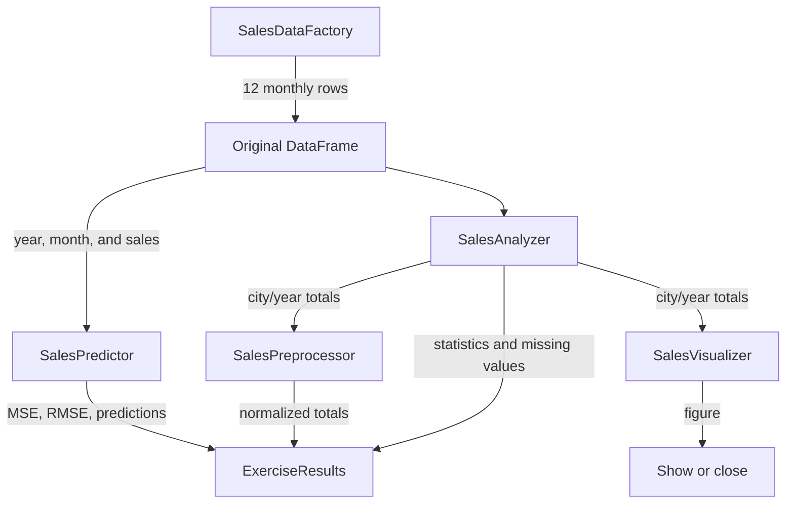

# Project architecture: retail sales exercise

This page describes the implementation of the [exercise brief](exercise.md): its structure, classes, data flow, and design decisions. The design is modular and intended for learning without introducing unnecessary layers.

## Design principles

- Use a Pandas DataFrame to pass tabular data between analysis components.
- Separate data creation, analysis, preprocessing, visualization, and modeling.
- Give each class one main responsibility and methods that are easy to test.
- Avoid silently modifying input DataFrames; return new results when transforming data.
- Use the original monthly records for model training. City/year aggregates are for the chart and normalization, not replacements for monthly training rows.

## Project layout

```text
Scikit-learn/
├── docs/
│   ├── en/
│   │   ├── index.md
│   │   ├── exercise.md
│   │   ├── architecture.md
│   │   └── code/
│   └── es/
│       ├── index.md
│       ├── exercise.md
│       ├── architecture.md
│       └── code/
├── src/
│   └── retail_sales/
│       ├── __init__.py
│       ├── __main__.py
│       ├── analysis.py
│       ├── data.py
│       ├── model.py
│       ├── preprocessing.py
│       ├── visualization.py
│       └── workflow.py
├── tests/
├── .github/workflows/docs.yml
├── mkdocs.yml
└── pyproject.toml
```

`docs/en/` and `docs/es/` contain English and Spanish versions with matching structures and English filenames. MkDocs Material and its localization plugin build the language selector and website. The `.github/workflows/docs.yml` workflow publishes changes to GitHub Pages. The `wiki/` directory contains a sample Wiki home page and sidebar linking to the published site rather than duplicating its content.

`src/retail_sales/` contains the reusable application logic. `__main__.py` is the package entry point. `tests/` verifies individual components and the complete flow. `pyproject.toml` declares the package and its dependencies.

Install the documentation tools with `python -m pip install -e ".[docs]"` and preview the site with `python -m mkdocs serve`. Build with strict validation using `python -m mkdocs build --strict`. Run the program tests with `python -m pytest`; launch the exercise with `python -m retail_sales` or `retail-sales`.

## Components

### `data.py` — `SalesDataFactory`

Creates a fresh DataFrame from the 12 dictionaries defined in the assignment. The input schema remains `Ciudad`, `Año`, `Mes`, and `Ventas`. The factory does not read files or perform analysis.

### `analysis.py` — `SalesAnalyzer`

Performs descriptive operations without drawing charts:

- `check_missing_values(dataframe)`: counts missing values per column.
- `describe_sales(dataframe)`: returns Pandas descriptive statistics for `Ventas`.
- `aggregate_sales(dataframe)`: returns total sales grouped by `Ciudad` and `Año`.

### `preprocessing.py` — `SalesPreprocessor`

- `normalize_totals(totals)`: adds `normalized_sales` in the range `[0, 1]` using NumPy, without modifying the input.
- `prepare_model_features(dataframe)`: maps Spanish month names to integers and returns `Año` and `month_number`.
- Validates required columns and rejects invalid or non-finite values where needed.

### `visualization.py` — `SalesVisualizer`

`plot_annual_sales(totals)` pivots the aggregated table and creates a grouped bar chart. It returns a Matplotlib `Figure`; the caller decides whether to show or close it. The chart uses English labels while the source DataFrame columns remain Spanish.

### `model.py` — `SalesPredictor`

The model uses only `Año` and `Mes`, as specified by the assignment. It converts the month to a number, performs a reproducible random 80/20 split, fits Scikit-learn `LinearRegression`, and returns predictions, MSE, RMSE, and split sizes in a `ModelEvaluation` object.

The model intentionally excludes `Ciudad`. As a result, it cannot distinguish city-specific sales. Adding city as a categorical feature would be a future extension, not part of the current assignment.

There are only 12 records, two years, and two months. A single random split is useful for practice but does not provide a robust estimate of real-world forecasting performance. A production forecast would need more time periods and a chronological evaluation.

### `workflow.py` — `SalesExercise` and `ExerciseResults`

`SalesExercise` accepts optional component instances or creates defaults. Its `run(show_plot=False)` method performs the exercise in sequence and returns an `ExerciseResults` object containing the source DataFrame, missing-value counts, statistics, annual aggregates, normalized aggregates, and model evaluation.

### `__main__.py` — package entry point

Runs the workflow, prints its tables and metrics, and requests the chart for interactive environments. Run it with `python -m retail_sales` after installing the package.

## Data flow



Aggregation and normalization belong to descriptive analysis. The predictor receives monthly observations so that predictions are evaluated at the same granularity as the source data.
