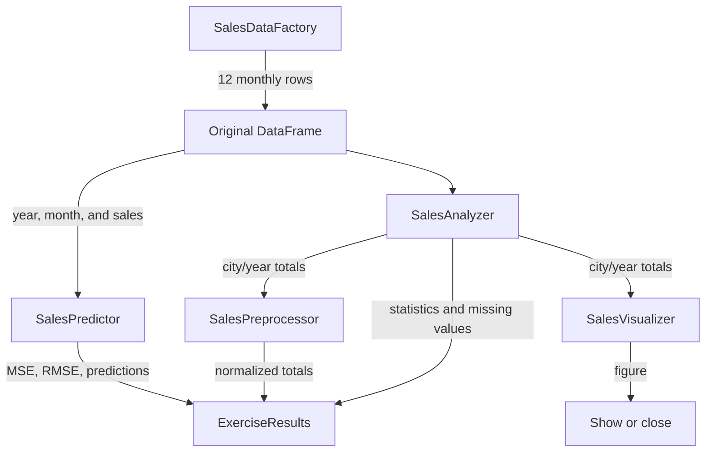

# `workflow.py`: connecting the exercise stages

Source file: [`src/retail_sales/workflow.py`](https://github.com/1YZTOOAr/Scikit-learn/blob/main/src/retail_sales/workflow.py).

## Purpose

This module coordinates the exercise. It creates the specialized components and runs them in order, delegating calculations to the appropriate class. It also defines the object that collects all results.

## `ExerciseResults`

This `dataclass(frozen=True)` contains the outputs of one run:

- `dataframe`: the 12 original monthly observations;
- `missing_values`: missing-value count per column;
- `sales_statistics`: descriptive sales statistics;
- `annual_sales`: totals grouped by city and year;
- `normalized_annual_sales`: the aggregate table with normalized values;
- `model_evaluation`: metrics, actual/predicted values, and model split sizes.

Grouping outputs in one object is easier to consume than returning many separate values. The frozen dataclass prevents attribute reassignment, although the contents of its Pandas DataFrames and Series remain mutable.

## `SalesExercise.__init__`

The constructor optionally accepts a data factory, analyzer, preprocessor, visualizer, and predictor. If an instance is not provided, it creates the default implementation.

This has two advantages:

1. Normal use is simple: `SalesExercise()` creates all default components.
2. Tests or future variants can inject alternative or mock components without rewriting orchestration.

The instances are stored on `self` and reused by `run()`.

## `run(show_plot=False)` step by step

1. `data_factory.create_dataframe()` creates the source table.
2. The analyzer checks missing values and calculates descriptive statistics.
3. The analyzer aggregates sales by city and year.
4. The preprocessor creates normalized totals. The original aggregate remains available for the chart.
5. The visualizer creates and returns a bar chart figure.
6. The predictor uses the original monthly DataFrame and evaluates a regression with `Año` and `Mes`.
7. If plotting was requested and Matplotlib reports an interactive backend, it calls `plt.show()`. Otherwise, it closes the figure to release resources and support headless tests.
8. Creates and returns `ExerciseResults` with all outputs.

`show_plot` defaults to `False`, so tests run without opening a window. `__main__.py` enables it for interactive use.

## Data flow

## Keep aggregation separate from modeling

City/year totals are used for the chart and normalization. The predictor uses monthly rows. Mixing six annual totals with twelve monthly observations would change the unit of observation and make the evaluation represent a different problem.

## Relationship to other modules

`SalesExercise` knows each component's interface, but does not need to know how Pandas groups data, how NumPy normalizes values, or how Scikit-learn fits regression. This separation makes each module easier to learn and test.