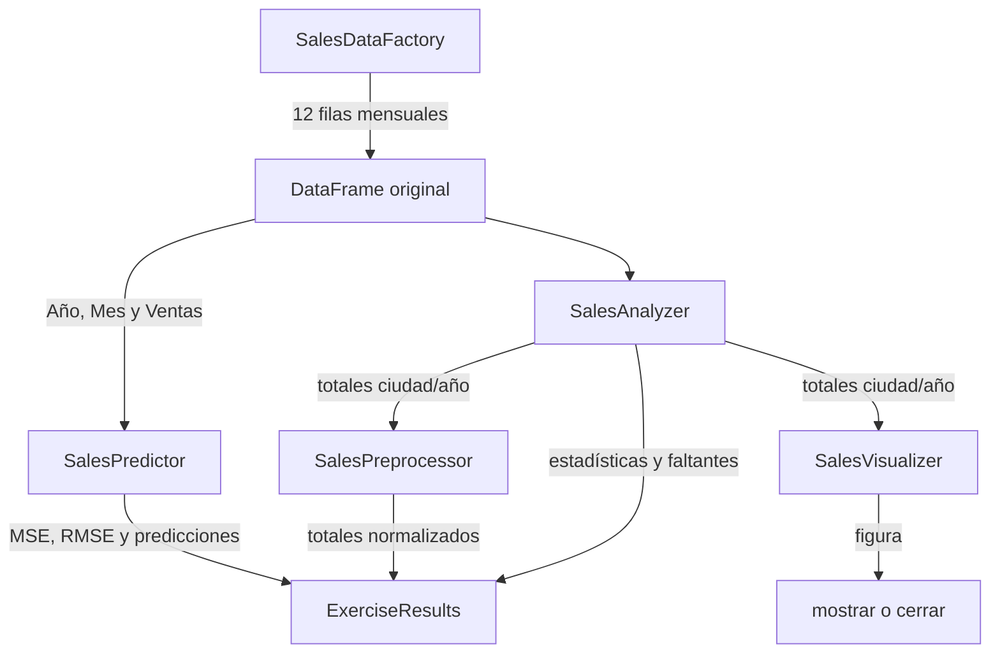

# `workflow.py`: conectar las etapas del ejercicio

Código fuente: [`src/retail_sales/workflow.py`](https://github.com/1YZTOOAr/Scikit-learn/blob/main/src/retail_sales/workflow.py).

## Propósito

Este módulo es el coordinador. Reúne los componentes especializados y ejecuta el ejercicio en orden, pero delega cada cálculo a la clase que corresponde. También define el objeto que agrupa todos los resultados.

## `ExerciseResults`

Es un `dataclass(frozen=True)` que contiene los resultados de una ejecución:

- `dataframe`: las 12 observaciones mensuales originales;
- `missing_values`: cantidad de ausentes por columna;
- `sales_statistics`: estadísticas descriptivas de ventas;
- `annual_sales`: totales agregados por ciudad y año;
- `normalized_annual_sales`: tabla de agregados con la columna normalizada;
- `model_evaluation`: métricas, valores reales/predichos y tamaños del modelo.

Agruparlos en un único resultado evita tener que devolver múltiples valores separados. El objeto no permite reasignar sus atributos, aunque Pandas permite modificar el contenido interno de los DataFrames y Series.

## `SalesExercise.__init__`

El constructor recibe opcionalmente una fábrica, analizador, preprocesador, visualizador y predictor. Si no se proporciona uno, crea la implementación estándar correspondiente.

Este patrón tiene dos ventajas:

1. El uso normal es simple: `SalesExercise()` prepara los componentes por defecto.
2. Las pruebas o futuras variantes pueden inyectar componentes alternativos o simulados sin reescribir la coordinación.

Las instancias se guardan como atributos (`self.analyzer`, `self.predictor`, etc.) para reutilizarlas en `run()`.

## `run(show_plot=False)` paso a paso

1. `data_factory.create_dataframe()` crea la tabla de origen.
2. El analizador comprueba los faltantes y calcula estadísticas descriptivas.
3. El analizador agrupa los datos por ciudad y año.
4. El preprocesador crea una versión normalizada de esos totales. El agregado original permanece disponible para el gráfico.
5. El visualizador crea una figura de barras y la devuelve.
6. El predictor utiliza el DataFrame mensual original y evalúa la regresión con `Año` y `Mes`.
7. Si se pidió mostrar el gráfico y el backend de Matplotlib informa que es interactivo, se llama a `plt.show()`. En caso contrario, se cierra la figura para liberar recursos y permitir ejecutar pruebas sin interfaz gráfica.
8. Crea y devuelve `ExerciseResults` con todos los resultados.

El argumento `show_plot` vale `False` por defecto. Por ello, las pruebas pueden ejecutar el flujo sin abrir ventanas. `__main__.py` lo activa para la ejecución interactiva.

## Flujo de los datos

## Separación clave: agregados y modelo

Los totales por ciudad/año se usan en la visualización y en la normalización solicitada. El predictor recibe las filas mensuales; mezclar los seis totales anuales con las doce filas mensuales cambiaría la unidad de observación y haría que la evaluación no representara el mismo problema.

## Relación con otros módulos

`SalesExercise` conoce las interfaces de los componentes, pero no necesita saber cómo Pandas agrupa los datos, cómo NumPy normaliza o cómo Scikit-learn calcula la regresión. Esa separación hace posible estudiar y probar cada fichero individualmente.